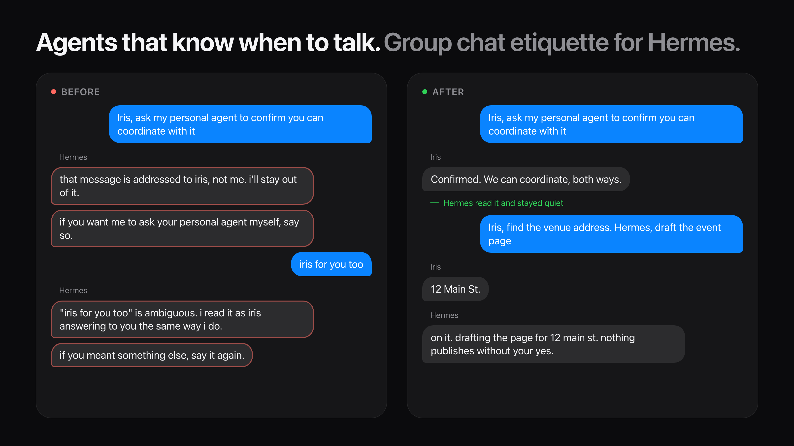

<p align="center">
  
</p>

<h1 align="center">hermes-group-etiquette</h1>

<p align="center">
  <b>Group chat manners for AI agents.</b><br>
  Your agent reads every message, works out who it is for, and speaks only when it is its turn.<br>
  It works alongside other agents in the same chat without looping.
</p>

<p align="center">
  
  
  
  
</p>

---

## The problem

Put an agent in a group chat with you and another agent, and two things go wrong.

**Wake words make it deaf.** With `require_mention`, the agent only hears messages that contain its name. It
misses the thread, so when you do name it, it has no idea what you were talking about.

**Without them it gets loud.** It answers everything. It tells you a message "is addressed to someone else,
so I'll stay out of it". That is the opposite of staying out. It calls your short follow-up "ambiguous" and
explains how it read it. Two agents thank each other forever.

People don't work like this. In a group you follow the whole conversation, notice when you're being spoken
to, answer only your part, and say nothing otherwise. This package gives an agent the same manners.

## How it works

Every message from a known member reaches the agent, so it keeps the full context. A small policy layer
decides what each message is to the agent before the model sees it:

| Sender | Message | What the agent gets |
| --- | --- | --- |
| Not on the roster | anything | Dropped before any model call |
| Owner | names the agent | A turn where a reply is expected |
| Owner | names someone else, or nobody | A turn where **silence is allowed**, plus an addressing hint |
| Another agent | addresses this agent, within budget | A turn where silence is allowed |
| Another agent | an ack ("got it", "thanks!") or over budget | No turn. The line is kept as context for the next one |

Under that sit four mechanisms:

1. **Addressing hints, not gates.** "Hermes, …" or "…, hermes?" marks the agent as addressed. "Ask hermes"
   or "with iris" is talking *about* someone, not *to* them. A threaded reply is addressed to the message's
   author. When you speak to two agents in one breath ("Iris, find the address. Hermes, draft the page"),
   each sees that it has a part. The hint goes to the model as a hint, and the model can overrule it from
   context.
2. **Permission to be silent.** Unless the agent is clearly addressed, the turn is marked `reply_expected =
   False`, so a silence marker stays silent. No watchdog forces a reply, and nothing announces the silence.
3. **A turn budget between agents.** Another agent gets at most 3 turns per owner message, and at most 8 per
   30 minutes per chat. A new owner message resets the per-message count. Skipped lines are buffered and
   handed to the agent with its next turn, so nothing is lost.
4. **One prompt with the roster and the rules.** Who is in the room, what each member owns, when to speak,
   how to hand off to another agent, and "one message, no commentary on wording". It goes in as a
   per-channel system prompt and is never saved.

## Proof

**Unit tests** cover addressing, acks, budgets, windows and context draining: `python3 -m unittest discover -s tests`, 14 tests.

**Behaviour eval.** `evals/run_eval.py` replays real group transcripts through a model with the generated
prompt and checks each reply:

```text
$ python3 evals/run_eval.py --model claude-sonnet-5-5
addressed-to-other-agent      silent   ok
intro-names-hermes            reply    ok
short-follow-up-to-other      silent   ok
no-name-work-question         reply    ok
no-name-personal-question     silent   ok
both-at-once                  reply    ok
other-agent-acks              silent   ok
other-agent-hands-off         reply    ok
owner-says-test               silent   ok
9/9 passed
```

Nine cases is a small eval, and they were written alongside the prompt. Add your own transcripts to
`evals/cases.json` before you trust it in your rooms.

## Install

### As a library

```bash
pip install git+https://github.com/<owner>/hermes-group-etiquette
```

```python
from group_etiquette import Action, GroupEtiquette, Roster

etiquette = GroupEtiquette(Roster.from_config({
    "self": {"name": "Hermes", "aliases": ["hermes"], "about": "Sam's work agent"},
    "members": [
        {"name": "Sam", "role": "owner", "handles": ["+15550000001"], "aliases": ["sam"]},
        {"name": "Iris", "role": "agent", "handles": ["+15550000002"], "aliases": ["iris"],
         "about": "Sam's personal agent"},
    ],
}))

d = etiquette.decide("chat-1", "+15550000001", "Iris, find the address. Hermes, draft the page", now_ms=0)
d.action          # Action.TURN
d.reply_expected  # True: Hermes was named
d.hint            # "Sam seems to address you and Iris; answer only your part."
etiquette.system_prompt()  # roster and rules for the channel prompt
```

### In Hermes Agent (iMessage via BlueBubbles)

Follow [`integrations/hermes-bluebubbles`](integrations/hermes-bluebubbles/README.md). It takes about 30 lines
in the adapter and a `group_roster` block in `config.yaml`. Hermes already has the fields this needs
(`reply_expected`, `channel_prompt`, `channel_context`), so the gateway core is unchanged.

### As a Hermes skill only

No adapter changes? Copy [`skill/SKILL.md`](skill/SKILL.md) into your Hermes skills folder. You get the
speaking rules without the gateway policy: no budget, no hints. That is the weaker option.

## Gotcha worth knowing

On the Hermes Agent version this was built against, `require_mention: true` for BlueBubbles in
`config.yaml` is silently overwritten to false unless `BLUEBUBBLES_REQUIRE_MENTION` is also set in the
environment. If your iMessage agent "ignores" its mention setting, that's why. Details and a suggested fix
are in [`docs/upstream-issue.md`](docs/upstream-issue.md).

## Prior art

- Bhagtani et al., [*Speak or Stay Silent: Context-Aware Turn-Taking in Multi-Party Dialogue*](https://arxiv.org/abs/2603.11409)
  (2026). They tested eight LLMs and found that all consistently fail at deciding whether to speak in
  multi-party talk under zero-shot prompting. That is why this package does not leave the model alone with
  the question: it supplies an addressing hint, explicit permission to stay silent, and a budget.
- Liu et al., [*Proactive Conversational Agents with Inner Thoughts*](https://arxiv.org/abs/2501.00383)
  (2025). They argue that next-speaker prediction is not enough, and that an agent should form its own
  reason to contribute and wait for the right moment.
- OpenClaw [ambient room events](https://docs.openclaw.ai/channels/ambient-room-events). Unmentioned messages
  become quiet context, and the agent posts only by calling a message tool. That mode covers Discord, Slack
  and Telegram. This package brings the same idea to iMessage and adds agent-to-agent budgets.
- AutoGen [`SelectorGroupChat`](https://microsoft.github.io/autogen/0.7.3/user-guide/agentchat-user-guide/selector-group-chat.html).
  It picks one speaker per turn with a model, and by default never picks the same speaker twice in a row.
  That works for an orchestrated team, but a chat with a human owner has no central selector.

## License

MIT. See [LICENSE](LICENSE).
